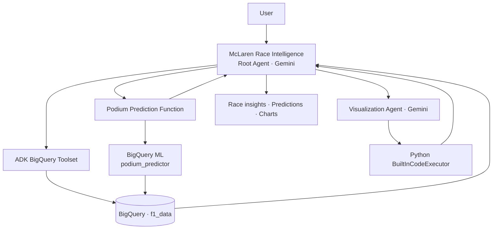
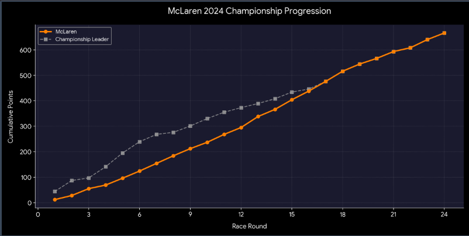
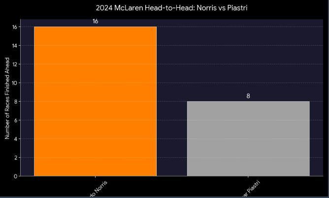
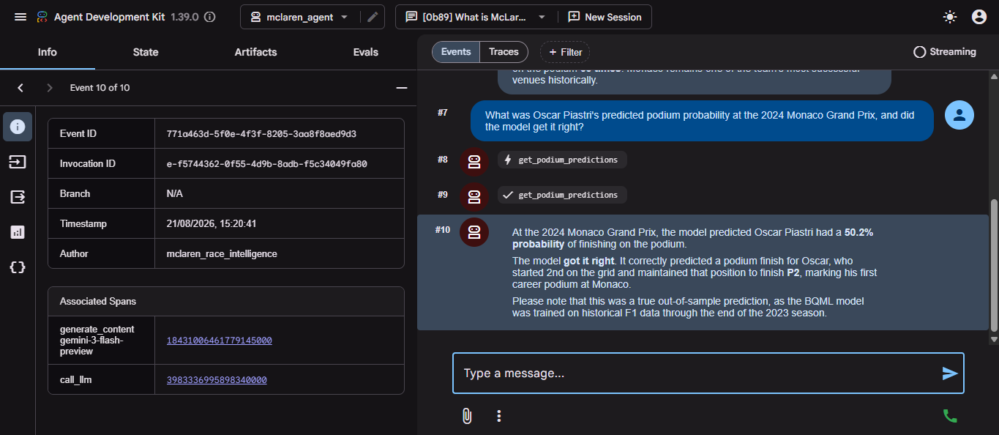
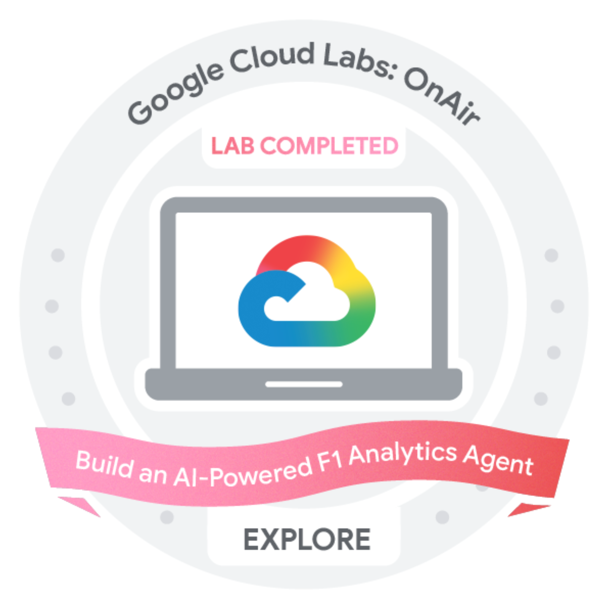

<div align="center">

# 🏎️ McLaren Race Intelligence

### AI-Powered Formula 1 Analytics Agent

**Turning historical Formula 1 data into actionable race insights with Agentic AI, Gemini, BigQuery, and BigQuery ML.**

<br/>


</div>

---

## 🏁 Overview

**McLaren Race Intelligence** is an AI-powered Formula 1 analytics project built with Google's Agent Development Kit (ADK). It gives users a natural-language way to explore McLaren's historical racing data, request podium predictions, and generate data visualizations.

The system combines a Gemini-powered root agent with BigQuery tools, a BigQuery ML prediction function, and a specialized visualization agent. Instead of limiting the experience to static dashboards or simple question answering, the agent can query structured race data, run an ML prediction workflow, and create charts through Python code execution.

> **Project focus:** Agentic AI · Formula 1 analytics · Cloud data engineering · Predictive machine learning

## ✨ Key capabilities

| Capability | What it does |
|---|---|
| Natural-language race analysis | Lets users ask questions about McLaren's historical Formula 1 performance. |
| BigQuery analytics | Uses the ADK BigQuery toolset to query the `f1_data` dataset and its analytical views. |
| Podium prediction | Calls a BigQuery ML model to estimate podium outcomes for a selected season. |
| Prediction evaluation | Compares predicted outcomes with actual results and returns summary statistics. |
| AI-powered visualizations | Delegates chart-generation requests to a specialized agent using Python code execution. |
| Historical data preparation | Includes notebooks for preparing and updating the Formula 1 dataset. |

## 🧠 Agent architecture

The application uses a root agent that coordinates three capabilities:

1. **BigQuery Toolset** — provides access to Formula 1 analytical data.
2. **Podium prediction function** — executes a controlled BigQuery ML `ML.PREDICT` query.
3. **Visualization agent** — uses `BuiltInCodeExecutor` to generate visualizations with Python.



## 📊 Analytics and visualizations

The project includes analytical SQL views designed to make McLaren race-performance data easier to query. The views cover race results, qualifying, season summaries, circuit history, championship progression, and pre-race ML features.

Add your two generated chart screenshots to the repository and update the image paths below. Suggested location: `assets/charts/`.

<div align="center">

| Chart 1 | Chart 2 |
|:---:|:---:|
| `assets/charts/chart-1.png` | `assets/charts/chart-2.png` |
| **Replace this cell with your first chart image** | **Replace this cell with your second chart image** |

</div>

Once the images are uploaded, replace the table above with:

```markdown
<div align="center">
  
  
</div>
```

## 🤖 Agent in action

Add screenshots of the running agent to `assets/agent/`. These can show the agent interface, a sample race-data question, a podium prediction response, or a generated visualization.

**Suggested image paths:**
- `assets/agent/agent-interface.png`
- `assets/agent/race-analysis.png`
- `assets/agent/podium-prediction.png`

Embed the screenshots in this section when they are available:

```markdown
<div align="center">
  
</div>
```

## 📈 Machine learning: podium prediction

The project includes a **Logistic Regression** classifier created with BigQuery ML.

- **Model:** `f1_data.podium_predictor`
- **Target:** `is_podium` — whether a driver finishes in the top three.
- **Training period:** McLaren race entries through the 2023 season.
- **Prediction period:** 2024 and later seasons are reserved for out-of-sample prediction demonstrations.
- **Data split:** Random split with a 15% evaluation fraction.

### Pre-race model features

The model uses information available before a race:

- Grid position
- Driver championship position entering the race
- Constructor championship position entering the race
- Driver's average finish at the circuit based on prior races
- McLaren's historical podium rate at the circuit
- Driver's rolling average finish over the previous five races

The agent's `get_podium_predictions()` function runs `ML.PREDICT`, extracts the predicted podium probability, compares predictions with actual outcomes, and returns a summary containing correct podium predictions, correct misses, missed podiums, false alarms, and overall accuracy.

**Important:** Model performance should be reported using the results obtained from your own BigQuery execution. No accuracy figure is assumed in this README.

## ☁️ Google Cloud lab achievement

<div align="center">

### Google Cloud Labs: OnAir

**Build an AI-Powered F1 Analytics Agent**



*Lab completed*

</div>

## 🛠️ Technology stack

| Layer | Technology |
|---|---|
| Agent framework | Google Agent Development Kit (ADK) |
| Generative AI | Gemini (`gemini-3-flash-preview`) |
| Data warehouse | Google BigQuery |
| Machine learning | BigQuery ML — Logistic Regression |
| Data processing | Python, Pandas |
| Visualization execution | ADK `BuiltInCodeExecutor` |
| Cloud services | Google Cloud, Cloud Storage |
| Data preparation | Jupyter notebooks |

## 📁 Repository structure

```text
mclaren-race-intelligence/
│
├── agent/
│   ├── mclaren_agent/
│   │   ├── __init__.py
│   │   ├── agent.py
│   │   └── prompts.py
│   ├── requirements.txt
│   └── setup.sh
│
├── notebooks/
│   ├── mclaren_data_prep.ipynb
│   └── mclaren_data_update.ipynb
│
├── sql/
│   ├── create_model.sql
│   ├── evaluate_model.sql
│   ├── create_views.sh
│   └── views.sql
│
├── certifications/
│   └── google-cloud-labs-onair-f1-analytics-agent.png
│
├── assets/
│   ├── charts/
│   └── agent/
│
├── .env.example
├── .gitignore
└── README.md
```

## ⚙️ Setup and run

### Prerequisites

- A Google Cloud project with billing enabled.
- BigQuery and Vertex AI permissions enabled for your project.
- Google Cloud CLI installed and authenticated.
- Python version compatible with the installed Google ADK dependencies.
- Access to the required Formula 1 dataset and BigQuery resources.
- Kaggle credentials if you are running the initial data-preparation notebook.

### 1. Clone the repository

```bash
git clone https://github.com/YOUR_USERNAME/mclaren-race-intelligence.git
cd mclaren-race-intelligence
```

### 2. Configure Google Cloud authentication

```bash
gcloud auth application-default login
gcloud config set project YOUR_PROJECT_ID
```

### 3. Set environment variables

Linux / macOS:

```bash
export PROJECT_ID="YOUR_PROJECT_ID"
export REGION="us-central1"
```

Windows PowerShell:

```powershell
$env:PROJECT_ID = "YOUR_PROJECT_ID"
$env:REGION = "us-central1"
```

The agent reads `PROJECT_ID` and `REGION` from the environment. It uses Google Application Default Credentials for authentication.

### 4. Install agent dependencies

```bash
cd agent
python -m venv .venv
```

Activate the virtual environment:

```bash
# Linux / macOS
source .venv/bin/activate
```

```powershell
# Windows PowerShell
.\.venv\Scripts\Activate.ps1
```

Install the dependencies:

```bash
pip install -r requirements.txt
```

### 5. Prepare BigQuery resources

Use the notebooks in the `notebooks/` directory to prepare and update the data. Configure your own Google Cloud Storage bucket and BigQuery project before running the notebooks.

Create the analytical views:

```bash
# Linux / macOS / Cloud Shell
export PROJECT_ID="YOUR_PROJECT_ID"
bash sql/create_views.sh
```

Create the podium prediction model by running:

```text
sql/create_model.sql
```

Run the evaluation queries in:

```text
sql/evaluate_model.sql
```

The agent expects the `f1_data` dataset, the required tables and views, and the `podium_predictor` model to exist in your configured project.

### 6. Launch the ADK development interface

From the directory containing the `mclaren_agent` package:

```bash
adk web
```

Open the local URL printed by ADK and select the `mclaren_agent` agent.

## 🔐 Security and configuration

- Never commit API keys, Kaggle credentials, service-account JSON files, access tokens, or `.env` files.
- Use environment variables, Colab Secrets, or Google Cloud Secret Manager for sensitive values.
- Configure your own Google Cloud project, storage bucket, datasets, and permissions.
- Review notebook cells and cloud resource settings before executing them.
- Keep generated data, credentials, and local environment files out of public commits.

## 📚 Data and project notes

The notebooks use an Ergast-derived Formula 1 dataset distributed through Kaggle and the Jolpica Ergast-compatible API for subsequent race updates. Review the applicable dataset and API terms and attribution requirements before redistributing data.

This repository contains the project source code, notebooks, and SQL assets. It does not include the underlying race dataset, deployed cloud services, BigQuery tables, or trained cloud model artifacts. Results depend on the data and cloud resources configured in your environment.

## 👨‍💻 Author

**Vishal J**

- GitHub: [@vxhll](https://github.com/vxhll)
- LinkedIn: [Vishal J](https://www.linkedin.com/in/vishal-j-btech/)
- Portfolio: [vxhll.github.io](https://vxhll.github.io/)

---

<div align="center">

**Built to explore the intersection of Formula 1, Agentic AI, and Google Cloud.**

*McLaren Race Intelligence — AI-powered insights for the world of racing.*

</div>
