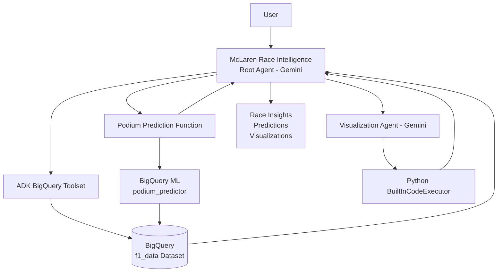
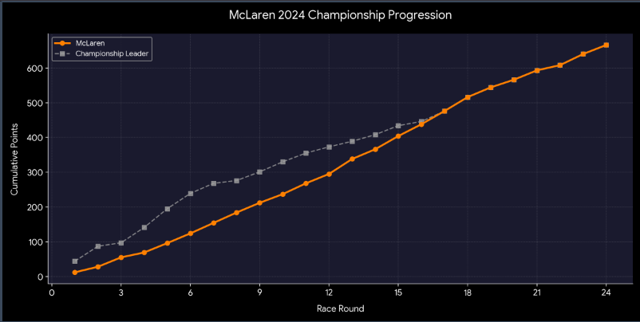
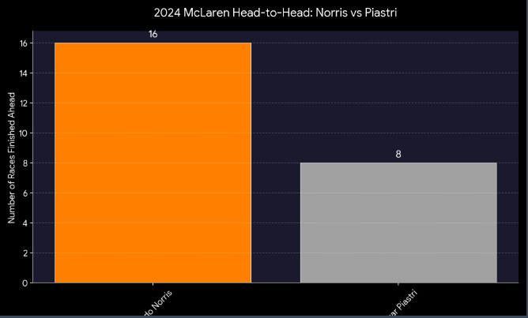
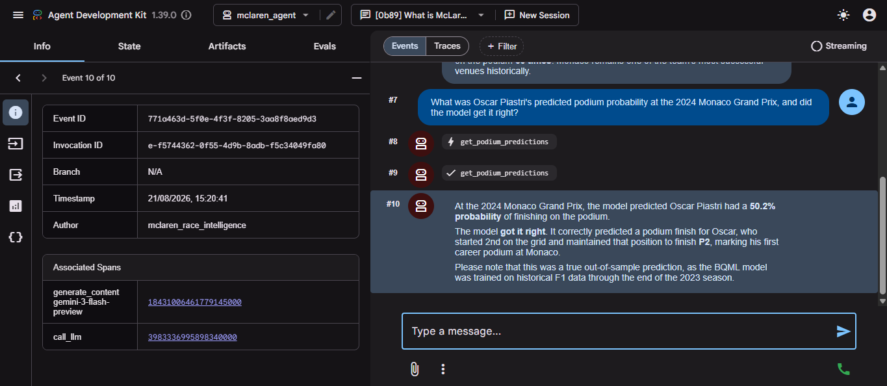
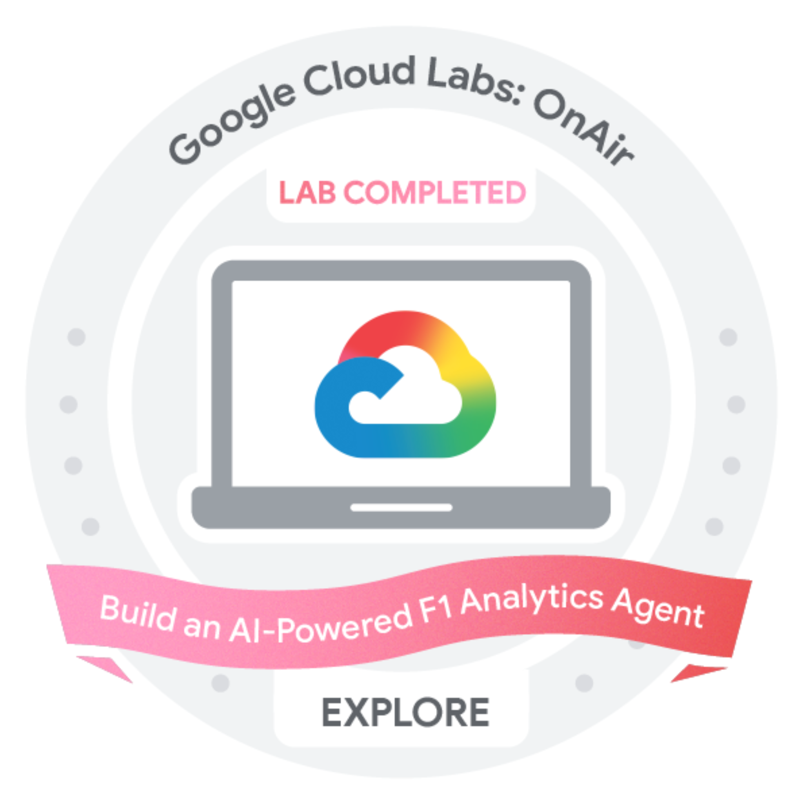

 <div align="center">

# 🏎️ McLaren Race Intelligence

### AI-Powered Formula 1 Analytics Agent

**Turning historical Formula 1 data into actionable race insights with Agentic AI, Gemini, BigQuery, and BigQuery ML.**


</div>

---

## 🏁 Overview

**McLaren Race Intelligence** is an independent AI-powered Formula 1 analytics project built using Google's Agent Development Kit (ADK).

The platform provides a natural-language interface for exploring historical Formula 1 racing data, analyzing McLaren's performance, generating podium predictions, and creating analytical visualizations.

Powered by Google's Gemini models, the application combines agentic AI workflows with BigQuery analytics and BigQuery ML to transform historical racing data into meaningful insights.

Rather than relying exclusively on static dashboards, users can interact with an AI agent that coordinates data queries, machine learning predictions, and Python-based visualization workflows.

> **Project focus:** Agentic AI · Formula 1 Analytics · Google Cloud · Predictive Machine Learning

## ✨ Key Capabilities

| Capability | Description |
|---|---|
| Natural-language race analysis | Ask questions about historical Formula 1 races, drivers, and McLaren performance. |
| BigQuery analytics | Retrieve structured racing statistics through the ADK BigQuery toolset. |
| Podium prediction | Generate podium probabilities using a BigQuery ML Logistic Regression model. |
| Prediction evaluation | Compare predicted podium outcomes with actual race results. |
| AI-powered visualization | Generate analytical charts using a specialized visualization agent and Python code execution. |
| Historical data preparation | Prepare and update Formula 1 datasets using Python notebooks. |

## 🧠 Agent Architecture

The application follows a multi-agent architecture coordinated by a Gemini-powered root agent.

### 1. Root Agent – McLaren Race Intelligence

- Powered by Google Gemini.
- Understands natural-language questions.
- Coordinates analytical tools and specialized agents.
- Returns racing insights and analytical results.

### 2. BigQuery Toolset

- Queries historical Formula 1 data.
- Accesses analytical views.
- Retrieves driver, constructor, circuit, and race statistics.

### 3. Podium Prediction Function

- Executes BigQuery ML `ML.PREDICT`.
- Retrieves podium probabilities.
- Compares predictions against actual race outcomes.

### 4. Visualization Agent

- Specialized agent for data visualization.
- Uses Python `BuiltInCodeExecutor`.
- Generates charts based on analytical requests.

### Architecture Diagram



## 📊 Analytics and Visualizations

The project includes analytical SQL views designed to explore historical Formula 1 performance and extract meaningful insights.

These analytical views support areas such as:

- Race results and driver performance.
- Qualifying statistics.
- Season summaries.
- Circuit performance history.
- Championship progression.
- Pre-race machine learning features.

### Analytical Chart Gallery

The following visualizations demonstrate the analytical capabilities of McLaren Race Intelligence.

<div align="center">

<table>
<tr>
<td width="50%" align="center">

**Chart 1 – Formula 1 Analytics**



</td>
<td width="50%" align="center">

**Chart 2 – 2024 McLaren Head-to-Head**



</td>
</tr>
</table>

</div>

The second chart compares the number of races in which Lando Norris and Oscar Piastri finished ahead of each other during the 2024 season.

These visualizations are generated through the project's Python-based visualization workflow.

## 🤖 AI Agent Interface – McLaren Race Intelligence

The application provides an interactive conversational interface powered by Google's Agent Development Kit.

Users can ask natural-language questions and receive analytical responses through the Gemini-powered agent.

### Live Agent Interface

<div align="center">



*McLaren Race Intelligence running in the Google ADK development interface.*

</div>

### Example: 2024 Monaco Grand Prix Podium Prediction

The agent was asked:

> What was Oscar Piastri's predicted podium probability at the 2024 Monaco Grand Prix, and did the model get it right?

The agent returned:

- **Predicted podium probability:** 50.2%.
- **Actual outcome:** Podium finish.
- **Starting position:** P2.
- **Finishing position:** P2.
- **Prediction result:** Correct.

The agent also identifies this as an out-of-sample prediction because the BigQuery ML model was trained using historical Formula 1 data through the end of the 2023 season.

This demonstrates how the application connects natural-language interaction with an actual BigQuery ML prediction workflow.

## 📈 Machine Learning – Podium Prediction

The project uses a **Logistic Regression classifier** built with BigQuery ML to estimate the probability of a driver achieving a podium finish.

### Model Configuration

| Property | Configuration |
|---|---|
| Platform | Google BigQuery ML |
| Model | `f1_data.podium_predictor` |
| Algorithm | Logistic Regression |
| Target variable | `is_podium` |
| Training data | Historical F1 data through 2023 |
| Prediction approach | Out-of-sample predictions on later seasons |

### Model Features

The model uses historical and pre-race information, including:

- Grid position.
- Driver championship position.
- Constructor championship position.
- Historical circuit performance.
- McLaren historical podium rate at the circuit.
- Driver's previous five-race average finish.

### Prediction Workflow

1. The agent receives a podium prediction request.
2. The prediction function prepares the relevant race information.
3. BigQuery ML executes `ML.PREDICT`.
4. The model returns podium probabilities.
5. Predictions are compared against actual race outcomes.
6. The agent presents the results in natural language.

### Model Evaluation

The prediction evaluation workflow compares predicted outcomes with actual results.

Evaluation metrics include:

- Correct podium predictions.
- Correct non-podium predictions.
- Missed podiums.
- False-positive podium predictions.
- Overall accuracy.

**Note:** Actual model performance depends on the configured BigQuery dataset and model evaluation results. No unsupported accuracy figures are claimed.

## ☁️ Google Cloud Achievement

<div align="center">

### Google Cloud Labs: OnAir

**Build an AI-Powered F1 Analytics Agent**



**Lab Completed**

</div>

This project builds upon the concepts explored in the Google Cloud Labs: OnAir lab, *Build an AI-Powered F1 Analytics Agent*.

## 🛠️ Technology Stack

| Layer | Technology |
|---|---|
| Programming language | Python |
| Agent framework | Google Agent Development Kit (ADK) |
| Generative AI | Google Gemini |
| Data warehouse | Google BigQuery |
| Machine learning | BigQuery ML |
| ML algorithm | Logistic Regression |
| Data processing | Pandas |
| Visualization | Python |
| Code execution | ADK BuiltInCodeExecutor |
| Cloud infrastructure | Google Cloud |
| Storage | Google Cloud Storage |
| Data preparation | Jupyter Notebooks |

## 📁 Repository Structure

```text
mclaren-race-intelligence/
│
├── agent/
│   ├── mclaren_agent/
│   │   ├── __init__.py
│   │   ├── agent.py
│   │   └── prompts.py
│   │
│   ├── requirements.txt
│   └── setup.sh
│
├── notebooks/
│   ├── mclaren_data_prep.ipynb
│   └── mclaren_data_update.ipynb
│
├── sql/
│   ├── create_model.sql
│   ├── evaluate_model.sql
│   ├── create_views.sh
│   └── views.sql
│
├── certifications/
│   └── google-cloud-labs-onair-f1-analytics-agent.png
│
├── assets/
│   ├── charts/
│   │   ├── chart-1.png
│   │   └── chart-2.png
│   │
│   └── agent/
│       └── agent-interface.png
│
├── .env.example
├── .gitignore
└── README.md
```

## ⚙️ Setup and Execution

### Prerequisites

Before running the project, ensure you have:

- A Google Cloud project with billing enabled.
- BigQuery and required Vertex AI permissions.
- Google Cloud CLI installed.
- Python installed.
- Access to the required Formula 1 dataset and BigQuery resources.
- Kaggle credentials if running the initial data preparation notebook.

### 1. Clone the Repository

```bash
git clone https://github.com/vxhll/mclaren-race-intelligence.git

cd mclaren-race-intelligence
```

### 2. Configure Google Cloud Authentication

```bash
gcloud auth application-default login

gcloud config set project YOUR_PROJECT_ID
```

### 3. Configure Environment Variables

Linux / macOS:

```bash
export PROJECT_ID="YOUR_PROJECT_ID"
export REGION="us-central1"
```

Windows PowerShell:

```powershell
$env:PROJECT_ID = "YOUR_PROJECT_ID"
$env:REGION = "us-central1"
```

The agent uses Google Application Default Credentials for authentication.

Use your own Google Cloud project configuration.

### 4. Install Agent Dependencies

```bash
cd agent

python -m venv .venv
```

Activate the virtual environment.

Linux / macOS:

```bash
source .venv/bin/activate
```

Windows PowerShell:

```powershell
.\.venv\Scripts\Activate.ps1
```

Install dependencies:

```bash
pip install -r requirements.txt
```

### 5. Prepare BigQuery Resources

Use the notebooks inside `notebooks/` to prepare and update the Formula 1 dataset.

Configure your own:

- Google Cloud project.
- Google Cloud Storage bucket.
- BigQuery dataset.
- Required permissions.

Create the analytical views:

```bash
bash sql/create_views.sh
```

Create the BigQuery ML model by executing:

```text
sql/create_model.sql
```

Run the model evaluation queries:

```text
sql/evaluate_model.sql
```

The application expects the required `f1_data` dataset, analytical views, tables, and `podium_predictor` model to be available in your configured BigQuery environment.

### 6. Launch the ADK Development Interface

From the directory containing the `mclaren_agent` package:

```bash
adk web
```

Open the local URL printed by ADK and select the `mclaren_agent` application.

You can now interact with McLaren Race Intelligence through the development interface.

## 🔐 Security and Configuration

Security is important when working with cloud-based AI applications.

- Never commit API keys or credentials.
- Never upload service-account JSON files.
- Keep `.env` files out of public repositories.
- Use environment variables or Google Cloud Secret Manager for sensitive configuration.
- Configure your own cloud resources and permissions.
- Review notebook cells before executing them.

## 📚 Data Sources and Project Notes

The project uses an Ergast-derived Formula 1 dataset distributed through Kaggle and the Jolpica Ergast-compatible API for subsequent race updates.

Review the relevant dataset and API terms and attribution requirements before redistributing data.

The repository contains the project source code, notebooks, and SQL assets. It does not include the underlying racing dataset, deployed cloud infrastructure, BigQuery tables, or trained cloud model artifacts.

Results depend on the data and cloud resources configured in your environment.

## 👨‍💻 Author

**Vishal J**

- GitHub: [@vxhll](https://github.com/vxhll/)
- LinkedIn: [Vishal J](https://www.linkedin.com/in/vishal-j-btech/)
- Portfolio: [vxhll.github.io](https://vxhll.github.io/)

---

<div align="center">

**Built to explore the intersection of Formula 1, Agentic AI, and Google Cloud.**

*McLaren Race Intelligence — AI-powered insights for the world of racing.*

</div>
